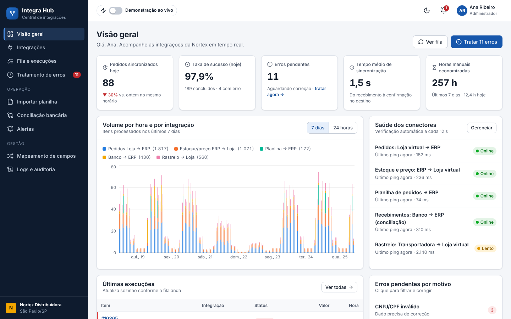

# Integra Hub

**Central de integrações entre loja virtual, planilhas, banco, transportadora e ERP**, com painel de acompanhamento, tratamento de erros e auditoria. Projeto de portfólio da **EMERICH Tech Solution** para demonstrar o serviço *Automações e integrações*.

> ⚠️ **Todos os dados são fictícios.** A empresa (Nortex Distribuidora), clientes, CNPJs, produtos, valores, credenciais e sistemas externos são inventados e simulados no navegador. Nenhuma chamada sai para serviços reais.



## O que a demonstração mostra

| Área | O que dá para fazer |
| --- | --- |
| **Login de demonstração** | Entrar com um clique como **Administrador** (acesso total) ou **Operador** (não acessa configurações, mapeamentos nem regras de alerta). |
| **Visão geral** | Pedidos sincronizados hoje, taxa de sucesso, erros pendentes, tempo médio, horas manuais economizadas, volume por hora e por integração (7 dias / 24 h) e saúde de cada conector com o último ping. |
| **Integrações** | Loja → ERP (pedidos), ERP → Loja (estoque e preço), Planilha → ERP, Banco → ERP (recebimentos) e Transportadora → Loja (rastreio). Liga/desliga, frequência (tempo real, a cada X min, horário fixo), credenciais fictícias mascaradas e **Sincronizar agora** com progresso. |
| **Fila e execuções** | Cada item com status (na fila, processando, concluído, erro, reprocessado, ignorado), duração e tentativas; filtros por integração, status, período e busca; linha do tempo *recebido → validado → transformado → enviado → confirmado* com payloads de entrada, saída e resposta em JSON. |
| **Tratamento de erros** | CNPJ inválido, produto sem cadastro no ERP, estoque insuficiente, timeout do ERP, título já baixado (e outros), explicados em português. Corrigir na hora e reprocessar, reprocessar em lote, ignorar com justificativa e **retentativas automáticas com backoff exponencial**. |
| **Mapeamento de campos** | De/para visual (ex.: `customer.document` → `A1_CGC`) com transformações (maiúsculas, remover máscara, converter unidade, tabela de equivalência, data, decimal…) e pré-visualização ao vivo com um registro real. |
| **Importar planilha** | Upload de CSV/XLSX, validação linha a linha com destaque das células, importação só das linhas válidas, relatório final e planilha de exemplo para download. |
| **Conciliação bancária** | Sugestões automáticas (nosso número, valor, CNPJ, nome, data), divergências (diferença de valor, sem título, duplicidade, vencidos) e conciliação manual. |
| **Alertas** | Regras do tipo “se a taxa de erro passar de X% em 15 min, avisar”, notificações no app e texto pronto do e-mail e do WhatsApp. |
| **Logs e auditoria** | Quem fez o quê e quando, com filtros e exportação para CSV. |
| **Demonstração ao vivo** | Interruptor no topo que gera pedidos novos a cada poucos segundos, com alguns erros, para o painel “se mexer” durante uma reunião. |

Também tem tema claro e escuro, layout responsivo (desktop, tablet e celular), navegação por teclado com foco visível e o botão **Restaurar dados de exemplo** (menu do usuário).

## Como rodar

Requisitos: Node.js 20 ou superior.

```bash
npm install
npm run dev          # http://localhost:5173
```

Outros comandos:

```bash
npm run build        # verifica os tipos e gera dist/
npm run preview      # serve o build localmente
npm run test         # testes unitários (Vitest)
npm run typecheck    # tsc --noEmit
npm run screenshots  # gera as capturas em docs/screenshots/ (Playwright)
```

Credenciais de demonstração (também há atalhos de um clique na tela de login):

| Perfil | E-mail | Senha |
| --- | --- | --- |
| Administrador | `ana.ribeiro@nortex.demo` | `demo123` |
| Operador | `carlos.mendes@nortex.demo` | `demo123` |

> Na primeira execução de `npm run screenshots` fora deste ambiente, rode `npx playwright install chromium` para baixar o navegador.

## Como publicar (GitHub Pages)

O workflow `.github/workflows/deploy.yml` faz typecheck, testes, build e publica no GitHub Pages **a cada push na branch `main`** (ou manualmente em *Actions → Publicar no GitHub Pages → Run workflow*).

1. No GitHub, abra **Settings → Pages**.
2. Em **Build and deployment → Source**, escolha **GitHub Actions**.
3. Faça push (ou merge) na `main`. Ao final do workflow o site fica em:
   `https://<usuario>.github.io/<repositorio>/` — neste repositório, **https://pedroemerich.github.io/integracao-erp/**

Detalhes técnicos:

- O `base` do Vite vem da variável `BASE_PATH` (o workflow usa `/<nome-do-repositorio>/`). Sem ela, o build usa caminhos relativos (`./`) e funciona em qualquer subpasta.
- As rotas usam **hash** (`#/fila`, `#/conciliacao`…), então recarregar qualquer página funciona no Pages sem `404.html`.
- GitHub Pages em repositório **privado** exige plano pago; em repositório público é gratuito.

## Arquitetura

```
src/
├── domain/            Regras puras, sem React (testadas com Vitest)
│   ├── documents.ts     CNPJ/CPF: validação, máscara, geração
│   ├── mapping.ts       Motor de de/para e transformações
│   ├── pipeline.ts      Validação + transformação de cada item
│   ├── errors.ts        Catálogo de erros em português e política de backoff
│   ├── reconciliation.ts  Pontuação e sugestões de conciliação, divergências
│   ├── spreadsheet.ts   Validação linha a linha e agrupamento da planilha
│   └── alerts.ts        Métricas, avaliação de regras, textos de e-mail/WhatsApp
├── connectors/
│   ├── types.ts         Interfaces: ErpConnector, StoreConnector, BankConnector,
│   │                    CarrierConnector, SpreadsheetSource
│   ├── index.ts         Roteamento por integração (buscar na origem, enviar ao destino)
│   └── simulated/       Implementações simuladas (latência, falhas, respostas realistas)
├── data/              Dados mestres fictícios e gerador dos dados de exemplo
├── store/
│   ├── useHub.ts        Estado global (Zustand) persistido no localStorage
│   └── engine.ts        Fila, execução das etapas, retentativas, ping, alertas, simulador
├── components/        Layout, painel do item, UI compartilhada
└── pages/             Uma tela por funcionalidade
```

### Fluxo de um item

1. **Recebido** — o item entra na fila (webhook simulado, “Sincronizar agora”, planilha ou simulador ao vivo).
2. **Validado** — regras de entrada (ex.: dígitos do CNPJ, padrão do código de rastreio).
3. **Transformado** — o mapeamento de/para converte o registro para o layout do destino; SKUs sem equivalência viram “produto sem cadastro”.
4. **Enviado** — o conector de destino é chamado. Erros **transitórios** (timeout, HTTP 503) são retentados sozinhos com espera crescente (2 s, 4 s, 8 s… até 4 tentativas — em produção seriam minutos). Erros de **dados** param e esperam correção.
5. **Confirmado** — a resposta do destino (ex.: número do pedido de venda no ERP) fica registrada.

Cada passo vai para a linha do tempo do item; cada ação humana vai para a auditoria.

### Conectores simulados e como trocar por reais

Toda comunicação com sistemas externos passa pelas interfaces de `src/connectors/types.ts`:

```ts
export interface ErpConnector {
  readonly name: string;
  ping(): Promise<PingResult>;
  createSalesOrder(order: Record<string, unknown>): Promise<ErpOrderResponse>;
  settleReceivable(settlement: Record<string, unknown>): Promise<ErpSettlementResponse>;
  listChangedProducts(limit: number): Promise<ErpProductChange[]>;
}

export interface StoreConnector {
  readonly name: string;
  ping(): Promise<PingResult>;
  fetchNewOrders(limit: number): Promise<StoreOrder[]>;
  updateInventory(payload: Record<string, unknown>): Promise<...>;
  updateFulfillment(payload: Record<string, unknown>): Promise<...>;
}
// + BankConnector, CarrierConnector, SpreadsheetSource
```

Hoje `src/store/engine.ts` cria os conectores com `createSimulatedConnectors(...)`. Para usar um sistema real:

1. Crie uma classe que implemente a interface (por exemplo `ProtheusRestConnector implements ErpConnector`, chamando a API REST do ERP; ou `VtexStoreConnector implements StoreConnector`).
2. Em caso de falha, lance `ConnectorError` com um erro do catálogo (`makeError('ERP_TIMEOUT', ...)`), para que a fila saiba se deve retentar.
3. Troque a criação dos conectores em `engine.ts`. Telas, fila, mapeamento, alertas e auditoria continuam iguais.

Em produção, as credenciais e as chamadas ficariam num backend (API própria ou funções serverless) — o navegador nunca deve guardar segredos reais. Esta demonstração roda 100% no navegador apenas para poder ficar no GitHub Pages.

### Persistência

O estado fica no `localStorage` do navegador (chave `integra-hub-data`). O botão **Restaurar dados de exemplo** recria tudo. Os dados de exemplo são gerados em relação à data atual (últimos 7 dias), então o painel sempre parece “de hoje”.

## Tecnologias

React 18 · TypeScript · Vite · Zustand · React Router (hash) · Recharts · lucide-react · SheetJS (xlsx) · Vitest · Playwright · CSS próprio com tokens de tema · GitHub Actions + GitHub Pages.

---

Demonstração · Desenvolvido por EMERICH Tech Solution
